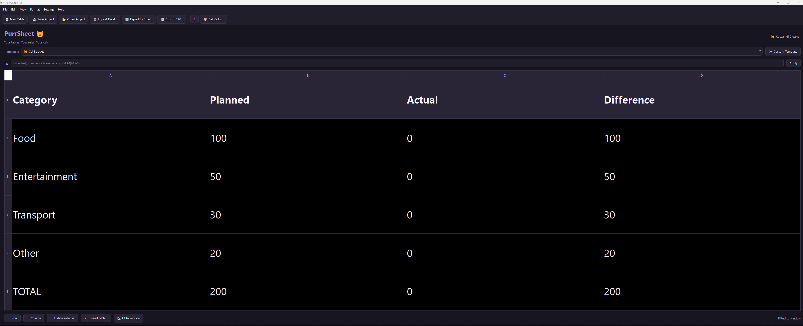

# 🐱 PurrSheet

**Уютная таблица для котов и людей.**
Формулы, шаблоны, круговые диаграммы, проверка обновлений, экспорт в Excel и CSV — и всё это в одном `.exe`.

---

## ✨ О PurrSheet

**PurrSheet** — лёгкий и красивый редактор таблиц для повседневных задач: бюджет, учёба, инвентарь, планы на неделю, игровая статистика. Никаких аккаунтов, облаков и подписок — просто открой и работай.

> Разработано компанией **MeowSoftware**.

---

## 🆕 Что нового

### v1.1.14

- 🐞 **Встроенная кнопка "Сообщить о баге"** — теперь в меню «Справка» есть быстрый доступ к созданию Issue на GitHub с заранее заполненным шаблоном (только для багов, не для уязвимостей).
- 🛡️ **Новая защита от DoS-атак** — перед открытием любого файла (`.purr`, `.xlsx`, `.csv`) проверяется его размер. Если он превышает 50 МБ, программа выдаст ошибку и не станет загружать его в память, что предотвращает переполнение памяти (OOM) и зависание системы.

**🐞 Исправленные баги (v1.1.13)**

- 🖱️ **Открытие `.purr` двойным кликом** — раньше запускалась пустая таблица, теперь открывается именно тот файл, по которому кликнули.
- 🌐 После смены языка в выпадающем списке шаблонов остаётся выбранный шаблон (а не сбрасывается на первый).
- 📏 Авто-рост таблицы больше не срабатывает при **очистке** последней ячейки — только когда в неё вводят данные.
- 🥧 Диаграмма с повреждёнными данными больше не «роняет» отрисовку таблицы.
- 🔄 Проверка обновлений корректно освобождает фоновый поток при закрытии окна — процесс не висит в памяти.
- 📂 Логика загрузки `.purr`-файла собрана в одном месте — нет расхождений между «Открыть» и «двойной клик».

**🛡️ Усиление безопасности (v1.1.13)**

- **CSV-инъекция** — при экспорте в CSV / Excel значения, начинающиеся с `=`, `+`, `@`, `|`, `\t`, `\r` или `\n`, экранируются. Открытие файла в Excel больше не выполнит потенциально опасную формулу.
- **HTML-инъекция** в диалогах обновлений — весь текст из GitHub API выводится строго как plain text.
- **Открытие URL** — разрешены только ссылки вида `https://github.com/...`.
- **DoS через формулы** — `=10**10**10` и подобные теперь дают `#ERROR!` вместо зависания. Ограничены база и показатель степени, а также битовая длина результата.
- **DoS через большие файлы** — при импорте Excel/CSV и открытии `.purr` действуют лимиты: 5000 строк, 200 столбцов, 10 000 символов на ячейку, 50 секторов в круговой диаграмме.
- **Валидация `.purr`-файлов** — повреждённая или враждебно сформированная структура не приводит к крашу, программа выдаёт понятную ошибку.
- **Ограничение ответа GitHub API** — максимум 1 МБ, чтобы огромный/подменённый ответ не съел память.

---

## 🖼️ Скриншот

*Главное окно PurrSheet: тёмная тема, шаблоны, строка формул, таблица на весь экран.*

---

## 🚀 Возможности

| | |
|---|---|
| 🧮 **Формулы** | `SUM`, `AVERAGE`, `MIN`, `MAX`, `COUNT`, арифметика, диапазоны `A1:A10` |
| 🥧 **Круговые диаграммы** | В ячейке, с легендой цветов и процентов; двойной клик — редактировать |
| 📊 **Экспорт / импорт** | Microsoft Excel (`.xlsx`) и CSV (`UTF-8 BOM`) |
| 💾 **Проекты** | Собственный формат `.purr` — сохраняет данные, формулы, цвета, стили и диаграммы |
| 🎨 **Оформление** | Цвет фона, цвет текста, жирный шрифт |
| 🔤 **Масштаб текста** | Шрифт в ячейке автоматически подстраивается под высоту строки |
| 📐 **Гибкая вёрстка** | Ручной ресайз столбцов/строк или автоподгонка под окно |
| 🌐 **Два языка** | Английский и русский, переключение прямо в приложении |
| 📦 **Шаблоны** | Готовые (бюджет, учёба, инвентарь, план) и свои собственные |
| 🔄 **Проверка обновлений** | Встроенная, через GitHub API |
| 🐞 **Сообщить о баге** | Быстрый доступ к созданию Issue на GitHub через меню «Справка» |
| 🐾 **Ошибки формул** | `#DIV/0!`, `#CIRC!`, `#ERROR!` — как в Excel |
| 🛡️ **Защита от потери данных** | Предупреждение о несохранённых изменениях при закрытии |

---

## 💾 Установка

> **Python НЕ требуется.** Всё уже внутри `.exe` — PySide6, openpyxl и все зависимости упакованы в один установщик.

### Windows 10 / 11

1. Откройте страницу [**Releases**](https://github.com/matvey2222222222/PurrSheet/releases).
2. Скачайте **`PurrSheet-Setup.exe`** (установщик).
3. Запустите установщик и следуйте шагам мастера.
4. Готово — ярлык **PurrSheet** появится в меню «Пуск».

Никаких `pip install`, никаких консольных команд. Просто скачал → установил → открыл.

### 📂 Открытие файлов `.purr`

Файлы проектов PurrSheet можно открывать **двойным кликом** прямо в проводнике Windows — программа сразу загрузит нужный проект. Также можно перетащить `.purr`-файл на ярлык PurrSheet.

---

## 🧭 Как пользоваться

1. Открой программу — стартует на весь экран.
2. Выбери шаблон из списка или нажми **✨ Свой шаблон**.
3. Введи значение или формулу в строку **`fx`** сверху — например `=SUM(B2:B5)`.
4. Тяни границы столбцов и строк — текст сам подстроится.
5. Сохрани проект (`File → Save Project`), экспортни в Excel или CSV.

### 🥧 Как добавить круговую диаграмму

1. Выдели ячейку.
2. Меню **Правка → Добавить → 🥧 Круговая диаграмма…**
   *(или кнопка 🥧 в нижней панели, или в тулбаре, или ПКМ по ячейке)*
3. В открывшемся редакторе:
   - **`＋ Добавить сектор`** — добавить долю;
   - клик по цветному квадрату — выбрать цвет;
   - ввести значение и подпись (например `Food: 30 (25%)`);
   - живое превью справа обновляется сразу.
4. Нажми **`Применить`** — диаграмма появится в ячейке.
5. **Двойной клик** по диаграмме — снова открыть редактор.

### 🔄 Как проверить обновления

- Тулбар → **`🔄 Проверить обновления`** (последняя кнопка справа), **или**
- Меню **Справка → 🔄 Проверить обновления**.

Программа стучится в GitHub API. Если есть свежий релиз — покажет номер версии, описание и предложит открыть страницу загрузки в браузере.

### Шпаргалка по формулам

| Что | Пример |
|---|---|
| Арифметика | `=A1+B1*2` |
| Степень | `=A1**2` |
| Сумма диапазона | `=SUM(A1:A10)` |
| Среднее | `=AVERAGE(B2:B5)` |
| Мин / Макс | `=MIN(A1:A3)+MAX(B1:B3)` |
| Количество | `=COUNT(A1:A100)` |

---

## 🌐 Языки

Интерфейс приложения полностью переведён на:

- 🇬🇧 **English**
- 🇷🇺 **Русский**

Сменить язык можно в любой момент: **Настройки → Язык / Settings → Language**. Выбор сохраняется.

---

## 🛡️ Безопасность

Начиная с версии **1.1.13** в PurrSheet устранены известные векторы атак, а в версии **1.1.14** добавлена дополнительная защита:

| Угроза | Защита |
|---|---|
| CSV-инъекция (выполнение формул при открытии `.csv`/`.xlsx` в Excel) | Экранирование `=`, `+`, `@`, `\|`, `\t`, `\r`, `\n` в начале значения |
| HTML-инъекция в диалогах | `QMessageBox` принудительно работает в режиме plain text |
| Открытие фишинговых URL | Разрешены только ссылки `https://github.com/...` |
| DoS через злонамеренные формулы (`=10**10**10`) | Ограничение базы, показателя степени и битовой длины результата |
| DoS через огромные `.purr`, `.xlsx`, `.csv` файлы | Лимиты: 5000×200 ячеек, 10 000 символов/ячейку, 50 секторов диаграммы |
| **DoS через переполнение памяти (OOM)** | **Проверка размера файла перед чтением (макс. 50 МБ для `.purr`, `.csv`, `.xlsx`)** |
| Повреждённые `.purr`-файлы | Строгая валидация структуры с понятными ошибками |
| Подмена ответа GitHub API | Ограничение размера до 1 МБ + проверка домена URL |

Если вы обнаружили уязвимость — **не пишите о ней публично**. Пожалуйста, следуйте инструкциям в [SECURITY.md](SECURITY.md) и напишите на **matveycat125@outlook.com**.

---

## 🐞 Нашли баг или ошибку?

**Напишите нам в [Issues](https://github.com/matvey2222222222/PurrSheet/issues)!**

Мы стараемся делать PurrSheet стабильным и удобным, но всё же возможны баги. Если вы столкнулись с ошибкой, странным поведением или чем-то, что не работает как ожидалось — создайте issue с описанием:

- что вы делали;
- что ожидали увидеть;
- что получилось на самом деле;
- версию PurrSheet и версию Windows.

Каждое сообщение помогает сделать приложение лучше. Спасибо! 🐾

> ⚠️ **Важно:** этот раздел — **только для багов и ошибок**. Если вы нашли **уязвимость в безопасности** — **не публикуйте её в Issues**. Следуйте инструкциям в [SECURITY.md](SECURITY.md) и напишите напрямую на **matveycat125@outlook.com**.

---

## 👨‍💻 О разработчике

Разработано matvey2222222222 из команды MeowSoftware.

---

## 📜 Лицензия

Данный проект является **проприетарным (закрытым)**. 
Все права защищены. Любое копирование, модификация или распространение исходного кода 
или скомпилированного приложения без письменного разрешения автора (MeowSoftware) запрещены.
---

**Сделано с ❤ и 🐾**

[🐱 Скачать PurrSheet](https://github.com/matvey2222222222/PurrSheet/releases)

